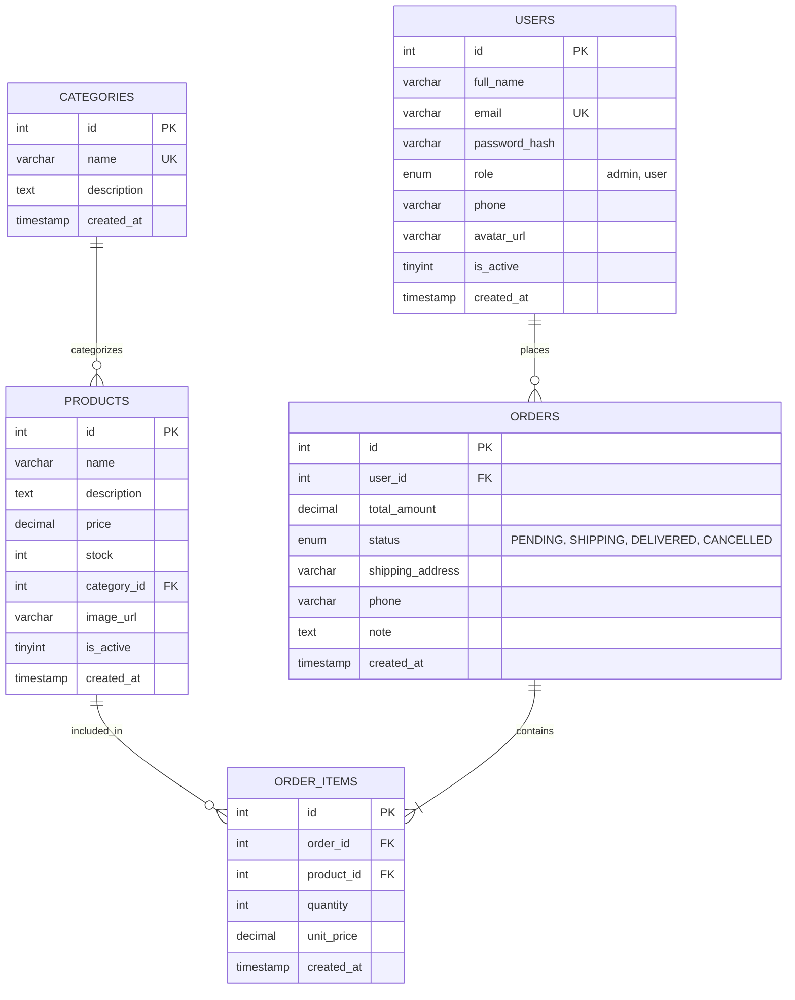

# 🛒 SGroup Backend E-Commerce RESTful API (Final Project 2026)

Hệ thống Backend RESTful API hoàn chỉnh phục vụ nền tảng bán hàng trực tuyến (E-Commerce), được phát triển trong khóa đào tạo **SGroup Backend Basic 2026**.

Dự án được xây dựng theo kiến trúc phân tầng chuẩn (**Route ➔ Controller ➔ Service ➔ Repository**), thiết kế cơ sở dữ liệu theo định dạng **Entity Classes**, sử dụng **Raw SQL thuần** với MySQL Connection Pool, tích hợp bộ đệm tốc độ cao **Redis (Cache-Aside Pattern)**, quy trình upload ảnh qua **Cloudinary Stream Pipeline**, giao dịch nguyên tử **Database Transaction** và đóng gói toàn diện bằng **Docker & Docker Compose**.

---

## 🏗️ 1. KIẾN TRÚC HỆ THỐNG & CÔNG NGHỆ CỐT LÕI

```
                                  ┌───────────────────────────────┐
                                  │      Client (Postman / Web)   │
                                  └───────────────┬───────────────┘
                                                  │ HTTP / JSON
                                                  ▼
┌─────────────────────────────────────────────────────────────────────────────────────────────────┐
│ DOCKER CONTAINER: BACKEND SERVICE (Express.js on Node.js 20)                                    │
│                                                                                                 │
│  [Middlewares]                                                                                  │
│   ├── Auth Middleware (JWT Bearer Verification)                                                 │
│   ├── Authorization Middleware (Role-Based: User vs Admin)                                      │
│   ├── Upload Middleware (Multer MemoryStorage + FileFilter: jpg/png/webp)                       │
│   └── Centralized Error Handler (400, 401, 403, 404, 409, 500)                                   │
│                                                                                                 │
│  [4-Layer Architecture]                                                                         │
│   ├── Routes (/api/auth, /api/users, /api/categories, /api/products, /api/orders)               │
│   ├── Controllers (Xử lý Request, Response, Status Code)                                        │
│   ├── Services (Business Logic, State Machine, Cloudinary Upload, Redis Cache-Aside)            │
│   ├── Repositories (Raw SQL, Connection Pool, Pessimistic Locking `FOR UPDATE`, Transactions)   │
│   └── Entities (UserEntity, ProductEntity, OrderEntity, OrderItemEntity, CategoryEntity)        │
└───────────────────────┬─────────────────────────────────────────┬───────────────────────────────┘
                        │                                         │
                        ▼ (Cache-Aside / Invalidation)            ▼ (Raw SQL & Transactions)
         ┌─────────────────────────────┐           ┌─────────────────────────────┐
         │ DOCKER CONTAINER: REDIS 7   │           │ DOCKER CONTAINER: MYSQL 8.0 │
         │  Port: 6379                 │           │  Port: 3306                 │
         │  - Cache danh sách sản phẩm │           │  - Users & Categories       │
         │  - Cache chi tiết sản phẩm  │           │  - Products & Orders        │
         │  - Invalidate khi có đổi tồn│           │  - Order Items              │
         └─────────────────────────────┘           └─────────────────────────────┘
```

---

## 🗄️ 2. SƠ ĐỒ THỰC THỂ CƠ SỞ DỮ LIỆU (ERD)



---

## ⚡ 3. CÁC TÍNH NĂNG KỸ THUẬT NỔI BẬT

### 3.1. Thiết kế Entity Files (`src/entities/`)
Thay vì để dữ liệu Database trôi nổi dưới dạng object tự do, hệ thống định nghĩa các lớp Entity:
* `UserEntity`: Đóng gói logic loại bỏ `password_hash` (`toResponseObject()`), kiểm tra tính hợp lệ của họ tên, email và số điện thoại.
* `ProductEntity`: Kiểm tra tính hợp lệ của giá bán và số lượng tồn kho không âm.
* `OrderEntity`: Quản lý **State Machine (Máy trạng thái đơn hàng)**. Ràng buộc các bước chuyển đổi hợp lệ (`PENDING ➔ SHIPPING ➔ DELIVERED` hoặc `PENDING ➔ CANCELLED`), khóa vĩnh viễn các trạng thái kết thúc (`DELIVERED`, `CANCELLED`).
* `OrderItemEntity`: Tính toán thành tiền tự động (`subtotal = quantity * unitPrice`).

### 3.2. Giao dịch Database Transaction & Chống Race Condition
Khi tạo đơn hàng (`POST /api/orders`):
1. Mở kết nối riêng từ Pool: `const conn = await pool.getConnection(); await conn.beginTransaction();`
2. Khóa dòng sản phẩm với **Pessimistic Locking** (`SELECT ... FOR UPDATE`) để tránh tình trạng nhiều người cùng đặt làm âm kho.
3. Kiểm tra sản phẩm còn hoạt động (`is_active = 1`) và tồn kho còn đủ (`stock >= quantity`).
4. Lưu giá snapshot tại thời điểm mua (`unit_price`) vào bảng `order_items`.
5. Trừ tồn kho trong bảng `products` (`UPDATE products SET stock = stock - ?`).
6. `await conn.commit();` — Nếu có bất kỳ lỗi nào, tự động `conn.rollback();` và hoàn trả kết nối.
7. Khi User hoặc Admin hủy đơn hàng (`CANCELLED`), hệ thống tự động chạy Transaction hoàn trả lại tồn kho vào kho sản phẩm.

### 3.3. Tối ưu hiệu năng với Redis Cache (Cache-Aside Pattern)
* Danh sách sản phẩm (`GET /api/products`) và chi tiết sản phẩm (`GET /api/products/:id`) được tự động lưu vào Redis Cache (TTL 300s - 600s).
* **Cache Invalidation:** Khi Admin thêm sản phẩm mới, cập nhật giá, sửa tồn kho, xóa sản phẩm, hoặc khi User đặt hàng thành công làm thay đổi tồn kho, hệ thống tự động xóa cache liên quan (`delByPattern('products:*')`).
* **Cơ chế Graceful Degradation:** Nếu Redis gặp sự cố hoặc tạm thời chưa bật, server vẫn hoạt động bình thường bằng cách truy vấn trực tiếp vào MySQL mà không gây crash ứng dụng.

### 3.4. Upload ảnh qua Cloudinary Pipeline
* Sử dụng `Multer memoryStorage()` nhận file ảnh trực tiếp vào RAM dưới dạng Buffer (chặn file quá 5MB và lọc chỉ cho phép `.jpg, .png, .webp`).
* Dùng Node.js `stream` (`Readable.from(fileBuffer).pipe(...)`) đẩy dữ liệu lên Cloudinary mà không cần ghi file rác ra ổ cứng máy chủ.
* Hỗ trợ upload ảnh Avatar người dùng (`POST /api/users/profile/avatar`) và ảnh sản phẩm (`POST /api/products/:id/image`).

---

## 🚀 4. KHỞI CHẠY BẰNG DOCKER COMPOSE (TIỀN ĐỀ BUỔI 21)

Chỉ với 1 câu lệnh duy nhất, toàn bộ hệ thống gồm 3 dịch vụ (**Backend Node.js + MySQL Database + Redis Caching**) sẽ được khởi tạo, tự động chạy script tạo bảng và nạp dữ liệu mẫu ban đầu:

```bash
# Điều hướng vào thư mục dự án
cd sgroup-be-basic-2026

# Khởi chạy toàn bộ hệ thống ở chế độ chạy ngầm (-d)
docker compose up -d --build
```

### Kiểm tra trạng thái các container:
```bash
docker compose ps
```
Kết quả hiển thị 3 service đều ở trạng thái `healthy` / `Up`:
* `sgroup_backend_api`: Cổng `3000:3000`
* `sgroup_mysql`: Cổng `3306:3306` (Khởi tạo sẵn DB `sgroup_db` qua `database/init.sql`)
* `sgroup_redis`: Cổng `6379:6379`

### Xem log hệ thống:
```bash
docker compose logs -f backend
```

### Tắt toàn bộ hệ thống:
```bash
docker compose down
```

---

## 🔑 5. TÀI KHOẢN MẪU BAN ĐẦU (SEED DATA)

Database đã được tạo sẵn 2 tài khoản với mật khẩu đã băm bằng bcrypt:

| Vai trò | Email | Mật khẩu | Quyền hạn |
|---|---|---|---|
| **Quản trị viên (Admin)** | `admin@gmail.com` | `Admin@123` | Quản lý sản phẩm, tồn kho, xem toàn bộ đơn hàng và đổi trạng thái |
| **Khách hàng (User)** | `user@gmail.com` | `User@123` | Đặt hàng, xem/hủy đơn của mình, cập nhật profile và avatar |

---

## 📡 6. BẢNG TỔNG HỢP RESTFUL API ENDPOINTS

Tất cả các API được gắn tiền tố: `http://localhost:3000/api`

### 6.1. Xác thực tài khoản (Authentication)
| Method | Endpoint | Quyền | Mô tả | Body mẫu |
|---|---|:---:|---|---|
| `POST` | `/auth/register` | Guest | Đăng ký tài khoản mới | `{"fullName": "Họ Tên", "email": "a@gmail.com", "password": "Pass@123", "phone": "0912345678"}` |
| `POST` | `/auth/login` | Guest | Đăng nhập nhận JWT Token | `{"email": "user@gmail.com", "password": "User@123"}` |
| `GET` | `/auth/me` | Bearer Token | Lấy thông tin tài khoản đang login | *(Không cần body)* |

### 6.2. Quản lý thông tin cá nhân (User Profile)
| Method | Endpoint | Quyền | Mô tả | Body / Form |
|---|---|:---:|---|---|
| `GET` | `/users/profile` | User / Admin | Xem thông tin cá nhân | *(Không cần body)* |
| `PUT` | `/users/profile` | User / Admin | Cập nhật họ tên, SĐT | `{"fullName": "Tên Mới", "phone": "0988888888"}` |
| `POST` | `/users/profile/avatar` | User / Admin | Upload avatar lên Cloudinary | `multipart/form-data` (key: `avatar`) |
| `GET` | `/users` | Admin | Lấy danh sách toàn bộ user | *(Query: `?page=1&limit=20`)* |

### 6.3. Danh mục sản phẩm (Categories)
| Method | Endpoint | Quyền | Mô tả |
|---|---|:---:|---|
| `GET` | `/categories` | Guest / User | Lấy danh sách toàn bộ danh mục |

### 6.4. Quản lý sản phẩm (Products & Stock)
| Method | Endpoint | Quyền | Mô tả | Body mẫu |
|---|---|:---:|---|---|
| `GET` | `/products` | Guest / User | Lấy danh sách sản phẩm (Có Redis Cache) | Query: `?search=iphone&categoryId=1&page=1&limit=10` |
| `GET` | `/products/:id` | Guest / User | Xem chi tiết sản phẩm (Có Redis Cache) | *(Không cần body)* |
| `POST` | `/products` | Admin | Thêm sản phẩm mới (Xóa cache) | `{"name": "iPad Mini 6", "price": 13500000, "stock": 10, "categoryId": 3, "description": "..."}` |
| `PUT` | `/products/:id` | Admin | Sửa thông tin sản phẩm (Xóa cache) | `{"name": "iPad Mini 6 64GB", "price": 12900000}` |
| `PATCH` | `/products/:id/stock` | Admin | Cập nhật tồn kho (Xóa cache) | `{"stock": 50}` |
| `POST` | `/products/:id/image` | Admin | Upload ảnh sản phẩm qua Cloudinary | `multipart/form-data` (key: `image`) |
| `DELETE` | `/products/:id` | Admin | Vô hiệu hóa sản phẩm (Xóa cache) | Query: `?hard=false` (mặc định soft-delete `is_active=0`) |

### 6.5. Quản lý đơn hàng (Orders & Transaction)
| Method | Endpoint | Quyền | Mô tả | Body mẫu |
|---|---|:---:|---|---|
| `POST` | `/orders` | User / Admin | Tạo đơn hàng mới (**Transaction**) | `{"items": [{"productId": 1, "quantity": 1}], "shippingAddress": "123 Lê Duẩn, Đà Nẵng", "phone": "0987654321", "note": "Giao giờ hành chính"}` |
| `GET` | `/orders/my-orders` | User / Admin | Xem danh sách đơn hàng của mình | Query: `?page=1&limit=20` |
| `GET` | `/orders/my-orders/:id` | User / Admin | Xem chi tiết đơn hàng của mình | *(Không cho xem đơn của người khác)* |
| `PATCH`| `/orders/my-orders/:id/cancel` | User / Admin | Hủy đơn (**Hoàn tồn kho**) | *(Chỉ được hủy khi đơn ở trạng thái PENDING)* |
| `GET` | `/orders/admin` | Admin | Xem toàn bộ đơn hàng hệ thống | Query: `?status=PENDING&page=1&limit=20` |
| `GET` | `/orders/admin/:id` | Admin | Xem chi tiết đơn hàng bất kỳ | *(Gồm thông tin khách hàng + items)* |
| `PATCH`| `/orders/admin/:id/status` | Admin | Cập nhật trạng thái đơn hàng | `{"status": "SHIPPING"}` hoặc `{"status": "DELIVERED"}` hoặc `{"status": "CANCELLED"}` |

---

## 🛠️ 7. KHỞI CHẠY THỦ CÔNG KHÔNG DÙNG DOCKER (CHO LOCAL DEV)

Nếu máy tính cá nhân đã có sẵn MySQL và Redis cục bộ:

```bash
# 1. Cài đặt thư viện
npm install

# 2. Tạo database sgroup_db và nạp file schema:
mysql -u root -p < database/init.sql

# 3. Chạy ứng dụng ở chế độ hot-reload
npm run dev
```
Mở trình duyệt truy cập: `http://localhost:3000/` để kiểm tra kết nối!
